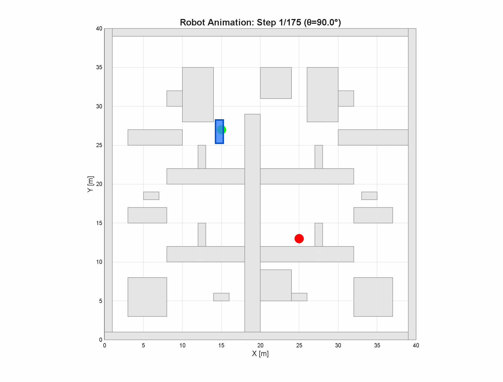
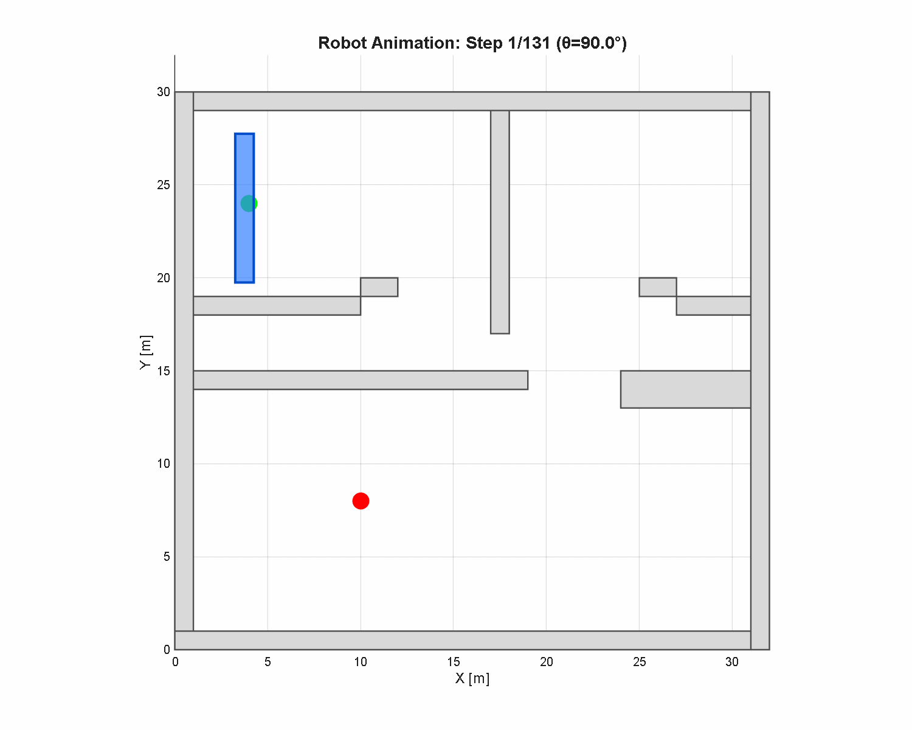

# Polygon robot obstacle avoidance path planning from C-Space to A* algorithm, MATLAB code

This code promises quality assurance and uniqueness across the network! If it cannot run, we will assist in proactive troubleshooting. If troubleshooting fails, a full refund is provided directly!
First, present an animated GIF to understand what this code does for this issue.
\n\n\n\nMore about this code: Such elegance! Polygon robot obstacle avoidance path planning from C-Space to A* algorithm, MATLAB code

## Images

<!-- PAYMENT_BLOCK -->

## Get this dataset

- Payment link (Stripe): [Buy now](https://buy.stripe.com/3cs8yP7sY87d0vu9AB)
- Payment QR code: 

<!-- /PAYMENT_BLOCK -->
